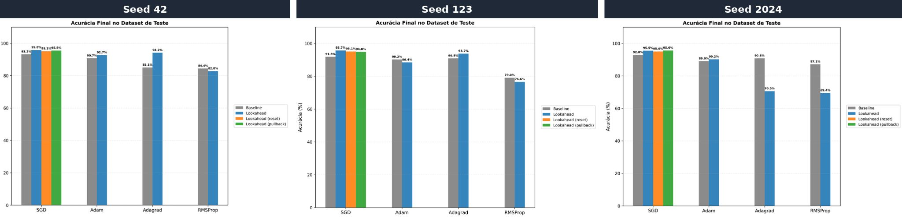
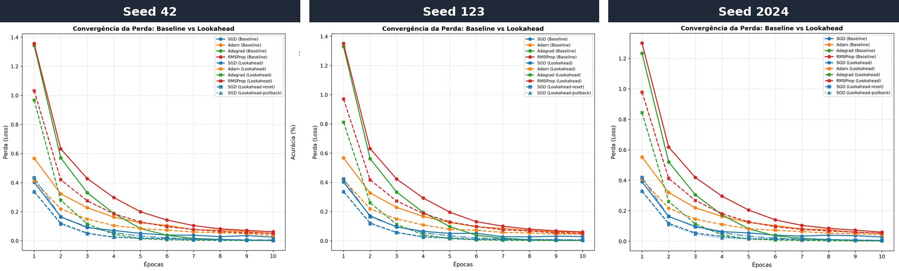

# Lookahead: k passos à frente, 1 passo atrás — funciona para qualquer otimizador?


[](LINK_DO_NOTEBOOK_NO_KAGGLE)
[](https://nbviewer.org/github/SEU_USUARIO/lookahead-optimizer-cifar10/blob/main/notebooks/lookahead_resnet18_cifar10.ipynb)

Estudo empírico do otimizador **Lookahead** ([Zhang et al., 2019](https://arxiv.org/abs/1907.08610)) aplicado sobre quatro otimizadores clássicos (**SGD com momentum, Adam, Adagrad e RMSProp**) no *fine-tuning* de uma **ResNet-18** pré-treinada no ImageNet, usando o dataset **CIFAR-10**.

A pergunta central: o Lookahead traz ganhos para SGD e Adam, como mostra o artigo original. **Ele traz os mesmos ganhos para otimizadores com falhas estruturais conhecidas**, como o Adagrad (decaimento prematuro da taxa de aprendizado) e o RMSProp (sem correção de viés)?

> Trabalho da disciplina de Introdução ao Aprendizado Profundo da **Universidade Federal do Maranhão (UFMA)**, feito por **Marcelo Albuquerque Heluy** e **Samuel Magalhães Pereira**.
>
> 📄 **[Leia o artigo completo (PDF)](artigo/Estudo_do_Otimizador_Lookahead.pdf)** · 🎤 [Slides da apresentação](artigo/apresentacao_slides.pdf)

---

## Principais resultados

**Acurácia final no conjunto de teste (%): média ± desvio padrão em 3 seeds (42, 123, 2024)**

| Otimizador | Configuração          | Acurácia (%)      |
|------------|-----------------------|-------------------|
| SGD        | Baseline              | 92,61 ± 0,73      |
|            | Lookahead (none)      | **95,66 ± 0,15**  |
|            | Lookahead (reset)     | 95,05 ± 0,04      |
|            | Lookahead (pullback)  | 95,31 ± 0,42      |
| Adam       | Baseline              | 89,95 ± 0,86      |
|            | Lookahead (none)      | **90,39 ± 2,15**  |
| Adagrad    | Baseline              | **88,90 ± 3,32**  |
|            | Lookahead (none)      | 86,13 ± 13,52     |
| RMSProp    | Baseline              | **83,54 ± 4,13**  |
|            | Lookahead (none)      | 76,24 ± 6,67      |





### Conclusões

- **SGD:** o Lookahead deu o maior e mais consistente ganho (**+3 p.p.** de acurácia e desvio padrão bem menor). O resultado se manteve nas três estratégias de tratamento do momentum (`none`, `reset`, `pullback`).
- **Adam:** ganho pequeno na média. Foi o otimizador adaptativo mais estável com o Lookahead.
- **Adagrad e RMSProp:** a perda de treino caiu mais rápido com o Lookahead, mas a generalização **ficou instável**. A seed 2024 teve queda forte (Adagrad 90,8% → 70,5%; RMSProp 87,1% → 69,4%). Uma hipótese é a dessincronia entre os pesos interpolados e o estado adaptativo interno do otimizador, que pode levar a mínimos que se ajustam bem ao treino mas generalizam mal.
- **Lição metodológica:** com uma única seed, a conclusão sobre o Adagrad seria oposta. Rodar várias seeds antes de generalizar faz diferença.

---

## Como o Lookahead funciona

O Lookahead encapsula um otimizador base e mantém dois conjuntos de pesos:

- **Pesos rápidos (θ):** atualizados normalmente pelo otimizador base durante *k* passos.
- **Pesos lentos (φ):** a cada *k* passos, são interpolados em direção aos pesos rápidos.

$$\phi_t = \phi_{t-1} + \alpha\,(\theta_{t,k} - \phi_{t-1}), \qquad \alpha \in (0, 1]$$

Depois disso, os pesos rápidos são reiniciados a partir dos lentos. Os pesos rápidos exploram o espaço de parâmetros e os lentos estabilizam a trajetória.

A implementação deste repositório é uma classe que herda de `torch.optim.Optimizer` e permite três estratégias para o estado interno (momentum) do otimizador base após cada sincronização:

| Estratégia  | Comportamento                                                |
|-------------|--------------------------------------------------------------|
| `none`      | Mantém o estado do otimizador base sem alterações            |
| `pullback`  | Aplica ao momentum a mesma interpolação usada nos pesos      |
| `reset`     | Zera o acumulador de momentum a cada *k* passos              |

---

## Metodologia

### Hipóteses

- **H1 (Convergência):** o Lookahead melhora a eficiência de convergência de todos os otimizadores base.
- **H2 (Estabilidade):** o Lookahead reduz a variância entre diferentes execuções.
- **H3 (Mínimos planos):** o Lookahead guia o treinamento para mínimos mais planos, que generalizam melhor.

Para o SGD, os resultados apoiam as hipóteses: a perda caiu mais rápido, a variância diminuiu e a acurácia de teste subiu. Para Adagrad e RMSProp, a H2 não se confirma, porque a variância entre seeds aumentou com o Lookahead.

### Configuração

| Item                 | Configuração                                                         |
|----------------------|----------------------------------------------------------------------|
| Modelo               | ResNet-18 pré-treinada no ImageNet (*fine-tuning*, nova camada de 10 classes) |
| Dataset              | CIFAR-10 (50.000 imagens de treino, 10.000 de teste)                 |
| Pré-processamento    | Pixels em [0, 1], redimensionamento de 32×32 para 224×224 (bilinear); sem *data augmentation* |
| Treino               | 10 épocas, mini-batches de 64, *cross-entropy*, sem *scheduler* de taxa de aprendizado |
| Lookahead            | k = 5, α = 0,5                                                       |
| Seeds                | 42, 123, 2024                                                        |
| Hardware             | Kaggle Notebooks, 2× NVIDIA Tesla T4                                 |

> **Diferença em relação ao artigo original:** Zhang et al. (2019) treinam do zero por 200 épocas, com *data augmentation* e decaimento da taxa de aprendizado. Aqui o regime é de *fine-tuning* curto, o que pode ser um fator adicional de instabilidade.

**Hiperparâmetros dos otimizadores base**

| Otimizador | Taxa de aprendizado | Outros                         |
|------------|---------------------|--------------------------------|
| SGD        | 0,01                | momentum 0,9; weight decay 5e-4 |
| Adam       | 0,001               | —                              |
| Adagrad    | 0,01                | —                              |
| RMSProp    | 0,001               | α = 0,99                       |

---

## Estrutura do repositório

```
lookahead-optimizer-cifar10/
├── notebooks/
│   └── lookahead_resnet18_cifar10.ipynb   # código completo dos experimentos
├── artigo/
│   ├── Estudo_do_Otimizador_Lookahead.pdf # artigo completo
│   └── apresentacao_slides.pdf            # slides da apresentação
├── images/                                # figuras usadas neste README
├── requirements.txt
└── LICENSE
```

## Como reproduzir

Para rodar localmente:

```bash
git clone https://github.com/SEU_USUARIO/lookahead-optimizer-cifar10.git
cd lookahead-optimizer-cifar10
pip install -r requirements.txt
```

1. Baixe a [versão Python do CIFAR-10](https://www.cs.toronto.edu/~kriz/cifar.html) e extraia os arquivos.
2. No notebook, troque o caminho `/kaggle/input/...` pelo diretório onde os arquivos foram extraídos.
3. Execute o notebook. É recomendado usar GPU, porque cada configuração leva vários minutos.

---

## Trabalhos futuros

- Investigar estratégias de sincronização do estado interno específicas para Adagrad e RMSProp (acumuladores de gradiente ao quadrado).
- Repetir os experimentos com o protocolo original de Zhang et al. (2019) (treino do zero, 200 épocas, *data augmentation* e decaimento da taxa de aprendizado) para isolar o efeito do *fine-tuning*.
- Ampliar o número de seeds e de épocas e medir a "planicidade" dos mínimos encontrados.

## Referências

- Zhang, M. R., Lucas, J., Hinton, G., Ba, J. (2019). *Lookahead Optimizer: k steps forward, 1 step back*. NeurIPS.
- He, K., Zhang, X., Ren, S., Sun, J. (2016). *Deep Residual Learning for Image Recognition*. CVPR.
- Kingma, D. P., Ba, J. (2015). *Adam: A Method for Stochastic Optimization*. ICLR.
- Duchi, J., Hazan, E., Singer, Y. (2011). *Adaptive Subgradient Methods for Online Learning and Stochastic Optimization*. JMLR.
- Tieleman, T., Hinton, G. (2012). *Lecture 6.5 — RMSProp*. COURSERA: Neural Networks for Machine Learning.
- Wilson, A. C. et al. (2017). *The Marginal Value of Adaptive Gradient Methods in Machine Learning*. NeurIPS.

A lista completa está no [artigo](artigo/Estudo_do_Otimizador_Lookahead.pdf).

## Autores

- **Marcelo Albuquerque Heluy**: [GitHub](https://github.com/maheluy) · [LinkedIn](https://www.linkedin.com/in/marcelo-albuquerque-heluy-56b594333/)
- **Samuel Magalhães Pereira**: [GitHub](https://github.com/samuelmpdev)
